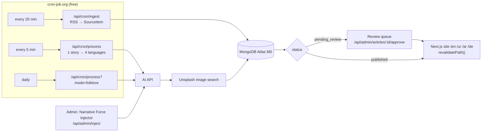

# Pak Dharti TV — Hybrid News Engine

## 1. How it fits together



Both pipelines write the **same `Article` document**. The only differences are
`origin` (auto/manual), the optional `campaign` link, and `placement`. So the
frontend, SEO, sitemaps and translations work identically for both.

## 2. Free-tier stack

| Need | Tool | Free-tier note |
|---|---|---|
| Frontend + API | Next.js on Vercel Hobby | Hobby is for non-commercial use; move to Pro once you run ads |
| Database | MongoDB Atlas M0 | 512 MB — SourceItem has a 7-day TTL to stay small |
| Scheduling | cron-job.org | Vercel Hobby crons run only once per day, so use an external pinger |
| Images | Unsplash API | Free, credit the photographer |
| AI | Google Gemini (Flash) | Free tier with daily request limits; Claude supported via AI_PROVIDER |

Why not one big cron job: serverless functions have a time limit, and one
4-language article takes ~20–45 s. So the work is split: `ingest` is cheap and
fetches feeds; `process` generates exactly **one** article per call; the scheduler
calls it frequently. Overlapping calls are safe because items are claimed atomically.

**Scheduler setup (cron-job.org):** create 3 jobs with header
`Authorization: Bearer <CRON_SECRET>`:
- `GET /api/cron/ingest` — every 20 min (your "3 times per hour" fetch)
- `GET /api/cron/process` — every 5–10 min
- `GET /api/cron/process?mode=folklore` — once a day

## 3. Narrative Force Injector flow

1. Admin types brief + options (category, content type, slot, review/instant),
   optionally pasting verified facts into **Source material**.
2. `POST /api/admin/inject` creates a `Campaign` (status `generating`).
3. AI writes the English master → Urdu, Arabic, German translated in parallel.
4. Unsplash image attached from an AI-suggested search phrase (automated articles use a fixed category banner instead, to respect Unsplash's API terms).
5. `Article` saved with `placement.slot = "breaking"`, priority 100, pinned for N hours.
6. `instant` → live immediately and all homepages revalidated; `review` → appears in
   the approval queue for one-click publish.

Homepage query:
```js
Article.find({ status: "published" })
  .sort({ "placement.priority": -1, publishedAt: -1 })
// after pinnedUntil passes, a nightly job (or the query) drops priority to 0
```

## 4. Frontend essentials

- Routes: `app/[lang]/page.js`, `app/[lang]/news/[slug]/page.js`
- `<html lang={lang} dir={["ur","ar"].includes(lang) ? "rtl" : "ltr"}>`
- Fonts: Noto Nastaliq Urdu (ur), Noto Naskh Arabic (ar), Inter (en/de) via `next/font`
- SEO: `hreflang` alternates for the 4 languages, per-language sitemap, `NewsArticle` JSON-LD
- If a translation is missing, render English with a small "translation pending" note
- Show the `contentType` badge (News / Feature / Opinion / Story), the image credit,
  source links, and an "AI-assisted" note — required for credibility and for Google
  News / AdSense eligibility

## 5. Editorial safeguards (built into the prompts and schema)

- AI may only state facts present in the source material: no invented quotes, numbers or statements.
- Every auto article stores and links its `sources`.
- Manual pieces default to `feature` and `review` mode; the badge tells readers it is a feature, not a wire report.
- `AUTO_PUBLISH=false` by default — flip to `true` only after you trust output quality.

## 6. Cost note

Each article = 4 AI calls. On Gemini's free tier the limit is requests per day,
so run `process` about once an hour (~24 articles/day ≈ 100 calls) plus your manual
injections. Free-tier limits change, so check them in Google AI Studio. On a paid
model, budget roughly a few US cents (Flash-class) to ~20 cents (Claude Sonnet) per article.

## 7. Calling the injector

```bash
curl -X POST https://YOUR-SITE/api/admin/inject \
  -H "x-admin-key: $ADMIN_API_KEY" -H "content-type: application/json" \
  -d '{
    "brief": "A special feature on Rabi-ul-Awwal and the Prophet ﷺ teachings on mercy, honesty and serving neighbours",
    "category": "religion",
    "contentType": "feature",
    "slot": "breaking",
    "publishMode": "instant"
  }'
```
In the admin panel, call this from a server action (with a NextAuth session check)
rather than from browser JavaScript, so the admin key never reaches the client.

## 8. Admin panel and analytics (added)

- `/admin` — password login (httpOnly cookie), the Injector form, the review queue
  (Publish / Reject), and a readership-by-category table.
- `/api/track` — counts one human view per article per session (bots filtered), updating
  `Article.stats` and the `DailyStat` collection.
- `/api/admin/export?type=articles|daily` — CSV export feeding `analysis/pak_dharti_analysis.ipynb`.
